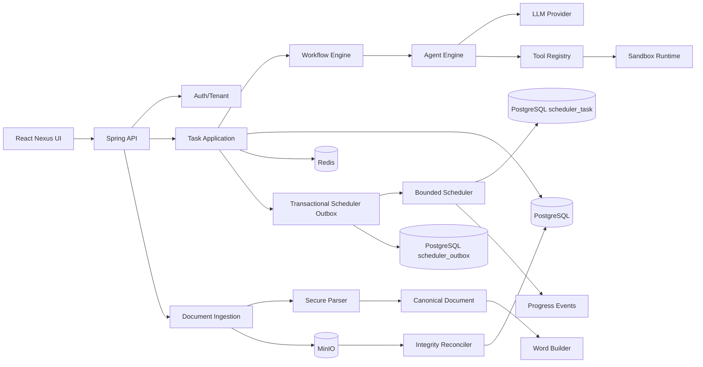

# ReportAI Architecture

The system is a modular monolith first. Domain/application modules depend on ports; Spring, PostgreSQL, MinIO, Apache POI, Docker and model SDKs are infrastructure adapters wired only at the composition root.

Hard boundaries:

- Agents never perform host/system side effects directly; they call tools.
- Provider tool-call responses are validated against declared tools, call budgets and bounded argument schemas before
  any application code can dispatch a tool.
- Runtime execution is sandboxed and policy-limited; no business `Runtime.exec`.
- Every tenant-scoped query includes tenant ownership criteria.
- Every create/import/execute command has idempotency and a database uniqueness guard.
- Documents are canonical JSON; binary files stay in object storage.
- DOCX embedded assets are extracted before AI processing, validated by media type and magic bytes,
  addressed by tenant-confined keys, and uploaded with SHA-256 verification before canonical JSON is persisted.
- Scheduler claims are lease/version guarded and persisted before worker dispatch; handlers are at-least-once safe.
- Task creation and scheduler publication are separated by a PostgreSQL transactional outbox. Publication is lease-based,
  idempotent and retryable, so a process crash cannot lose a committed task. Published delivery rows are removed only
  after the configured retention period; scheduler execution history remains durable.
- Workflow transitions append durable versioned events; live scheduler progress is fan-out through an authenticated,
  bounded SSE adapter and is not treated as the durable source of truth.
- LLM access is provider-neutral at the domain boundary; the current HTTP adapter is OpenAI-compatible and wrapped by request/response guards.
- Prompt templates are versioned in PostgreSQL and rendered through a repository-backed bounded renderer; active-version changes
  are protected by a partial unique index and transactional deactivation.
- Conversations are tenant-scoped aggregates with append-only messages and bounded page reads. PostgreSQL enforces the composite
  tenant/conversation foreign key so a message cannot cross tenant boundaries. History pagination uses an exclusive
  `(created_at, id)` keyset cursor so equal-timestamp messages cannot be skipped.
- Conversation prompts are assembled by a bounded context-window orchestrator. It reserves output tokens, retains newest
  history in chronological order, truncates pathological messages, and injects a deterministic bounded summary for omitted
  history. The compactor is a port with deterministic default and optional LLM-backed semantic implementation, so provider
  changes do not alter persistence or agent contracts.
- Durable memory snapshots persist the summary and its exclusive `(created_at, message_id)` boundary with CAS versioning;
  context assembly reuses the snapshot and only considers messages appended after that boundary.
- A separate bounded lifecycle worker selects only conversations with messages newer than the snapshot, retries transient
  compaction failures a configured number of times, and exposes Micrometer counters/timers without logging conversation text.
- Release/export is review-gated and bounded; an export is never emitted when deterministic completeness review fails.
- A successful task persists its review-gated DOCX as a tenant-owned `TASK/OUTPUT` object-integrity record. The task
  export endpoint reads that immutable artifact through the checksum-verifying object resolver; the legacy document
  export endpoint remains a canonical-document rebuild/preview path and is not used as the task delivery artifact.
- Object integrity verification is bounded and resumable. Failed objects remain visible for alerting/retry. Physical orphan
  cleanup is age-gated by an explicit retention policy, validates tenant-confined keys, protects live object-key references,
  deletes provider bytes before metadata, and retains failed deletions for later retry.
- Infrastructure acceptance tests live in a separate Maven module activated only by the `integration` profile. They use
  Testcontainers for PostgreSQL, MinIO, Redis and Docker runtime evidence so ordinary local development remains free of
  a Docker prerequisite while CI/staging can exercise real dependencies.
- The active Nexus React desktop shell treats each `.desktop-window-content` as an inline-size container. Internal apps
  use container queries for their own window width; embedded portfolio apps remain isolated in responsive iframes. This
  keeps two simultaneously open windows independent instead of coupling their layout to the browser viewport.
- Shell chrome assets are kept separate from application icons: the reference traffic-light SVGs and favicon live under
  `public/mac-icons`/`public`, while the shared Notes glyph is a React component reused by Dock, menus and Finder.
- Embedded portfolio applications own their internal responsive layout. Reddit's feed/sidebar boundary uses a centered
  grid with a sidebar-collapse breakpoint and narrow-content caps, rather than inheriting the shell's viewport or a fixed
  desktop offset. This prevents a normal portfolio window from depending on full-screen browser width.
- The generated-code runtime is fail-closed. Runtime images require immutable
  SHA-256 references; requested network egress and credential-shaped
  environment names are rejected before Docker creation. Containers run
  non-root with dropped capabilities, `no-new-privileges`, a read-only root,
  disabled networking, bounded resources and forced cleanup. Managed egress
  and split read-only-input/read-write-output mounts remain release work.
