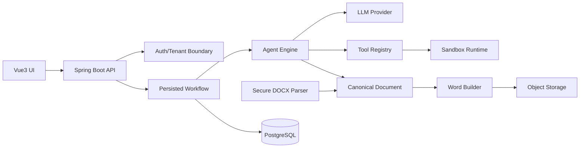

# ReportAI architecture baseline



The composition root is the only place that knows concrete adapters. Domain modules depend on ports. A future adapter may use Apache POI, Docker, MinIO, Redis, PostgreSQL, or a specific model SDK without changing agent logic.

## Runtime trust boundary

Generated code enters `DockerRuntimeEngine` through a fail-closed policy
boundary. Runtime images are immutable digest references, network requests are
rejected until routed through a managed egress proxy, and credential-shaped
environment variables are never forwarded to the workload. Docker isolation
and release evidence are specified in
[`docs/security/runtime-sandbox.md`](security/runtime-sandbox.md).

## First aggregate boundaries

- `ReportTask`: tenant, source document, current status, optimistic-lock version,
  and the first resolved `manifest_digest`; the digest is database-immutable
  once Preflight locks the execution environment.
- `WorkflowInstance`: definition version, current node, state snapshot, retry metadata, audit timestamps.
- `Execution`: runtime request, policy snapshot, stdout/stderr/object references, exit status.
- `Document`: normalized blocks, placeholders, questions, and asset references.

## Command safety

Create/import/upload/execute commands carry an idempotency key. The key is scoped by tenant and operation, and the request fingerprint is compared before a prior resource is returned. A database unique constraint (or an atomic Redis `SET NX` adapter with expiry) remains the final concurrency guard; the in-memory adapter is development/test only.

Uploads are accepted only after size, extension, media type, filename, and file-signature checks. Production adapters must additionally scan the file, parse DOCX with external entities disabled, enforce archive entry and expansion limits, and store the object under a server-generated key outside the web root.

## Required database constraints (next milestone)

- Unique `(tenant_id, idempotency_key, operation)` on command records.
- Unique `(tenant_id, report_id)` and ownership predicates on every read/update/delete.
- Version column on task/workflow/execution records for optimistic locking.
- Indexes beginning with tenant key for all tenant-scoped tables.

## Long-running Agent execution and upstream gateway resilience

Report tasks are durable scheduler jobs, not request/response operations. The
scheduler claims a task with a lease, renews that lease while the handler is
running, persists one Agent checkpoint at a time, and publishes progress to the
durable PostgreSQL event history. Clients may disconnect and reconnect through
SSE using `Last-Event-ID`; the task continues independently of the browser.

The LLM boundary follows the same separation used by Codex's app-server:
request initiation and task execution are independent, while progress and
terminal state are observable events. OpenAI-compatible providers never log
prompts, response bodies, endpoints or credentials. Each request carries the
durable task id as a bounded correlation id and records only provider, status,
duration and stable error code.

The configured gateway has an approximately two-minute origin limit. Coder
requests therefore use a shorter local attempt budget (`coder-timeout`), a
bounded output budget, and an automatic lower-reasoning fallback after
`LLM_TIMEOUT`, HTTP 408 or HTTP 524. Planner and Reviewer retain the global
reasoning setting. This prevents a single high-reasoning Coder call from
consuming all scheduler attempts while preserving a deterministic retry and
checkpoint boundary. If both attempts fail, the task remains retryable and the
failure is visible as a safe error code rather than a generic timeout.

## Report Forge release boundary

The report task is released only after this durable sequence has completed:

```text
parse → planner → catalog resolver → preflight → coder
     → installer → execution → artifact persistence → cleanup
     → deterministic document assembly → reviewer → DOCX export
```

`documentDraft` is retained in the checkpoint as model/audit material and must
be strict JSON containing anchored answer patches. The released report uses
the uploaded DOCX as its source of truth: `TemplatePreservingWordBuilder`
opens that source and applies only validated local edits at the requested
anchors. This preserves styles, table geometry, merged cells, relationships
and original media. Verified artifact references are resolved separately and
inserted as figures near their anchor; code, manifests, stdout and stderr stay
out of the experiment正文.

Execution artifacts use a separate `tasks/<tenant-hash>/...` namespace and a
dedicated tenant-bound resolver. The document resolver accepts only
`documents/<tenant-hash>/...`; an artifact download therefore cannot be turned
into a document-path traversal or cross-tenant read.

## Sandbox filesystem contract

Each runtime workspace contains two host directories:

```text
<workspace>/input   mounted read-only at /workspace/input
<workspace>/output  mounted read-write at /workspace
```

Generated source is written to `output`, while input material is supplied under
`input` (manifest input paths are relative to that directory). The container has a read-only root filesystem, no network, no Linux
capabilities, `no-new-privileges`, a non-root UID, bounded CPU/memory/PIDs and a
bounded tmpfs. Artifact keys are returned with the `output/` prefix so the
application persistence boundary can resolve them without trusting a host path.
