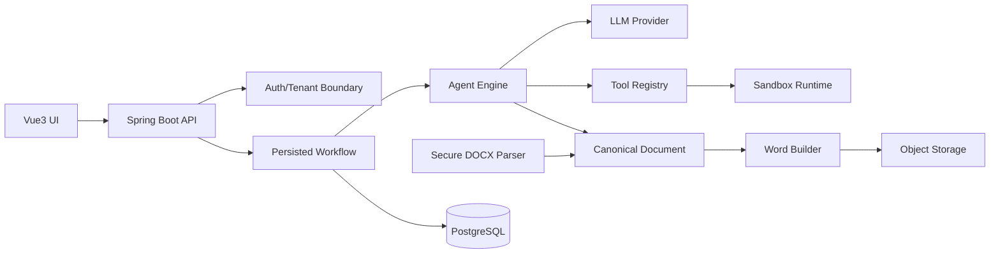

# ReportAI architecture baseline

The composition root is the only place that knows concrete adapters. Domain modules depend on ports. A future adapter may use Apache POI, Docker, MinIO, Redis, PostgreSQL, or a specific model SDK without changing agent logic.

## First aggregate boundaries

- `ReportTask`: tenant, source document, workflow id, current status, idempotency key, optimistic-lock version.
- `WorkflowInstance`: definition version, current node, state snapshot, retry metadata, audit timestamps.
- `Execution`: runtime request, policy snapshot, stdout/stderr/object references, exit status.
- `Document`: normalized blocks, placeholders, questions, and asset references.

## Command safety

Create/import/upload/execute commands carry an idempotency key. The key is scoped by tenant and operation, and the request fingerprint is compared before a prior resource is returned. A database unique constraint (or an atomic Redis `SET NX` adapter with expiry) remains the final concurrency guard; the in-memory adapter is development/test only.

Uploads are accepted only after size, extension, media type, filename, and file-signature checks. Production adapters must additionally scan the file, parse DOCX with external entities disabled, enforce archive entry and expansion limits, and store the object under a server-generated key outside the web root.

## Required database constraints (next milestone)

- Unique `(tenant_id, idempotency_key, operation)` on command records.
- Unique `(tenant_id, report_id)` and ownership predicates on every read/update/delete.
- Version column on task/workflow/execution records for optimistic locking.
- Indexes beginning with tenant key for all tenant-scoped tables.
